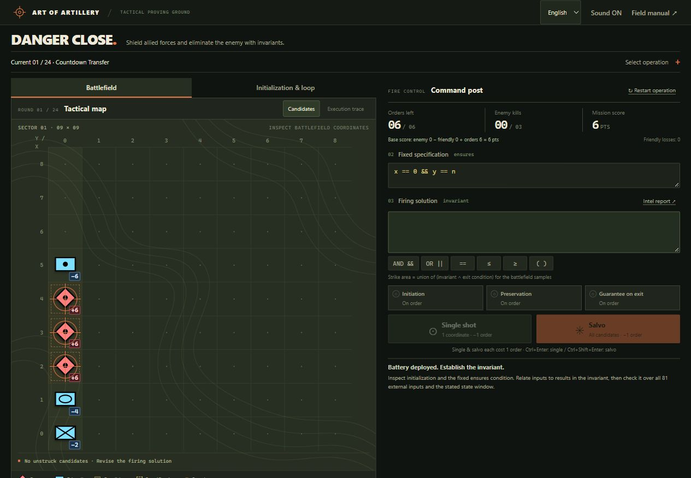

# Art of Artillery: Danger Close

Command artillery by writing loop invariants. Eliminate enemy units while protecting friendly forces across 24 operations.

## Run

Play directly in your browser. No installation is required:

- [Play on GitHub Pages](https://shha-03.github.io/art-of-artillery-danger-close/)
- [Play on OpenAI Sites](https://art-of-artillery-danger-close.duskykoala25.chatgpt.site/)

To run the game locally, install Node.js 20 or later, then run this command from the project directory:

```sh
node server.mjs
```

Open [http://127.0.0.1:4173](http://127.0.0.1:4173) in a modern browser. The committed files include the Z3 solver, so local play needs no dependency installation or build step. Use the server rather than opening `index.html` directly. Stop the server with `Ctrl+C`.

The page may reload once during startup. Your first firing order also loads the solver, so verification can take longer than later orders. If the browser cannot start Z3, the game reports an incomplete check and spends no order; try opening the game in a standalone browser.

## Test

Install the pinned test dependencies with npm, then run the complete suite from the project directory:

```sh
npm ci
npm test
```

Tests use Node.js 20 or later and include real Z3 verification of all 24 example solutions.

To run only the 24-operation proof checks after installing dependencies:

```sh
node --test smt-campaign.test.mjs
```

## How to play



The battlefield map is on the left; the invariant editor and firing controls are on the right.

1. Select an operation and open **Initialization & loop**. Read the program and its fixed, read-only `ensures` condition: the result you want to guarantee when the loop exits.
2. Write a condition in the empty **Firing solution** field. It must hold after initialization and remain true after every loop iteration. Use only the condition, without the `invariant` keyword or a semicolon.
3. Switch to **Battlefield**. Use the **Candidates** and **Execution trace** buttons above the map to **toggle the candidate area and execution trace on or off independently**. In three-variable operations, change the `z` layer to inspect other parts of the battlefield.
4. Issue a **Single shot** or **Salvo**. Review the checks and any counterexample, then refine your invariant before the next order.
5. Eliminate every enemy. A fully verified final shot also earns the score multiplier described below.

Use **Intel report** when you need help. Its first hint includes the former default formula as a reference; it does not fill the editor. The final hint reveals an example solution and explanation. Restarting or switching operations starts with an empty invariant field.

Expressions support integers, the operation's variables and input constants, `+ - * / %`, comparisons, `&&`, `||`, `!`, parentheses, `true`, and `false`. For example, combine bounds as `x >= 0 && x <= n`. `/` is integer division and `%` returns a nonnegative remainder. Consult the in-game **Field manual** for the full syntax and verification details.

Keyboard shortcuts: `Ctrl+Enter` fires a single shot; `Ctrl+Shift+Enter` fires a salvo. The language selector switches between Korean and English without resetting the operation. Sound can be toggled independently.

## Basic rules

- Each operation starts with **six orders**. A single shot hits one unstruck candidate; a salvo hits every unstruck candidate. Either costs **one order**, including salvos across all `z` layers.
- Candidates satisfy both your invariant and the loop's exit condition for the displayed battlefield inputs. Target priority is **neutral, then friendly, then enemy**; ties use coordinate order. Previously struck cells are never targeted again. Selecting a layer changes only the view.
- Checks run in sequence: **Initiation → Preservation → Guarantee on exit**. Failed initiation or preservation stops later checks and produces a dud: one order spent, no damage.
- A failed guarantee on exit still permits firing and damage if initiation and preservation passed. Syntax or arithmetic errors, unavailable Z3, and inconclusive or timed-out checks stop the order without charging it. Empty inputs cannot fire; an otherwise valid order with no remaining candidates also costs nothing.
- Destroying all enemies completes the operation, even without a guarantee on exit. Running out of orders while enemies remain ends the operation in failure.
- Blue rectangular units are friendly; red diamond units are enemies. Destroyed units gain or lose points according to their branch:

| Branch | Symbol inside the frame | Enemy destroyed | Friendly destroyed |
| --- | --- | ---: | ---: |
| Infantry | Crossed lines | +2 | -2 |
| Armor | Oval | +4 | -4 |
| Artillery | Dot | +6 | -6 |

```text
Base score = enemy points gained - friendly points lost + orders remaining
Final score = base score × verification multiplier
```

The multiplier is **2** when the shot that eliminates the last enemy passes all checks, including the fixed specification. Otherwise it is **1**. The multiplier applies to the entire base score. Completed scores cannot be changed by a later recheck; restart to try again. Best scores are saved for completed operations.

Best scores are stored in this browser, separately for each site address. Records from the earlier bounded checker are retained separately from scores earned with Z3.

Single shots limit each order's damage; salvos offer a higher score by conserving orders but expose every candidate to fire. A more precise invariant helps exclude friendly positions.

Z3 verifies the obligations over mathematical integers, including arbitrary external inputs and states outside the map. Only a proved result passes a check; a timeout or unknown result does not. These checks establish partial correctness: if the loop exits, the proved postcondition holds. They do not prove that the loop terminates.

For further reading, see [implementation details](docs/implementation.md) and [operation explanations and solutions](docs/levels.md).

## Reference
[Artillery Shooting Sound Effect](https://youtu.be/W2nyFCjJz7k?si=JNjK6oVgqv1KoUdV)
